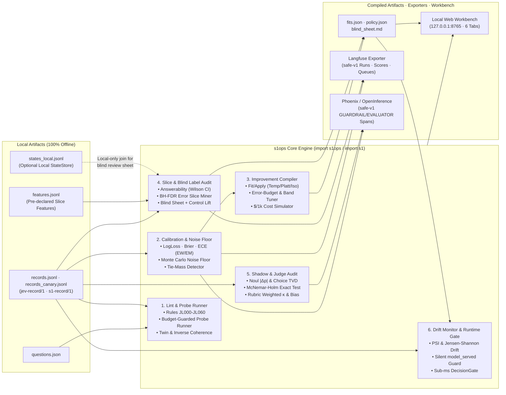

# `s1ops` — Dedicated System 1 LLMOps Platform & SDK

> **The dedicated System 1 LLMOps SDK for sub-100ms reflexive inference (`noul` / `choice` / `score`).**
>
> **Repository**: `pandas-studio/s1ops` · **PyPI**: `s1ops` · **Python**: `import s1ops` / `import s1` · **CLI**: `s1` / `s1ops`

`s1ops` is an offline-first, vendor-neutral evaluation, calibration, threshold compilation, blind label audit, and observability platform purpose-built for **Typed Decision Models (System 1)**:
- **TypeSafe `/v1/systemone`**: `jev-1.13.0`, `kev-1.0`, `laya`, `von` (`noul`, `choice`, `score`)
- **OpenAI `/v1/decisions`**: `gpt-6-luna` (`predicate`, `choice`)
- **Local / Custom Heads**: DeBERTa, ModernBERT, BGE rerankers, and constrained logprob classifiers emitting normalized probability distributions.

---

## Documentation Index

- **[docs/ARCHITECTURE_AND_PLAN.md](docs/ARCHITECTURE_AND_PLAN.md)**: Full architecture blueprint, vendor-neutral data contracts (`s1-record/1`, `jev-calib-fit/2`, `s1-policy/1`, `safe-v1`), 6-tab Web Workbench specification, and Phase 1–3 implementation roadmap.
- **[docs/REVIEW_AND_COMPARISON.md](docs/REVIEW_AND_COMPARISON.md)**: Comparative analysis against `Langfuse` & `Arize Phoenix`, empirical System 1 failure modes encoded as guardrails, and package/CLI naming & registry review (`s1ops` vs `reflex-ops` vs `fastloop`).
- **[docs/NEXT_STEPS_PLAN.md](docs/NEXT_STEPS_PLAN.md)**: Phase 4 follow-up roadmap covering GitHub remote/CI setup, live HTTP backend adapters (`HttpSystemOneBackend` / `OpenAIDecisionsBackend`), `DecisionGate` `choice`/`score` extensions, and `@pandas-studio/sys1` TypeScript SDK integration.

---

## Why System 1 Models Need Dedicated LLMOps

Traditional LLMOps platforms (**Langfuse**, **Arize Phoenix**, **LangSmith**) are architected for **System 2 generative workflows** (free-text completions, prompt templates, multi-turn RAG chains, token streaming latency). When applied to **System 1 decision models**, seven critical gaps emerge:

| Dimension | System 2 LLMOps (Langfuse / Phoenix) | `s1ops` (System 1 LLMOps) |
| --- | --- | --- |
| **Primary Output** | Unstructured text (`string`) | Calibrated probability vector (`noul` $p \in [0,1]$, `choice` $\Delta^{K-1}$, `score` $0..L-1$) |
| **Aggregation Unit** | Trace / Prompt Name | Strict **`(question_id, model_served, primitive)`** group — never pools across wordings or models |
| **Calibration & Small-$n$ Bias** | None (only scalar scores) | **Equal-width/mass ECE**, **Monte Carlo Calibrated Noise Floor (`p95`)**, **Tie-Mass rounding detector**, **Temp/Platt/Isotonic** post-hoc fit |
| **Decision Thresholds & Routing** | Hardcoded `0.5` in app code | **Tie-safe Error-Budget Threshold (`select_threshold` + Clopper-Pearson)**, **System 1 → System 2 Escalation Band (`[lo, hi)`)**, & **`DecisionGate` Runtime Evaluator** |
| **Prompt / Question QA** | Free-form prompt playground | **Static Linter (`JL000`–`JL060`)** + **Probe Coherence** (Noul vs Yes/No Choice twin gap & inverse sum $\|p + p_{\text{inv}} - 1\|$) |
| **Distribution & Model Drift** | Token/latency or generic embedding drift | **Label-Free Probability PSI & Jensen-Shannon Divergence**, **Silent `model_served` Upgrade Alert**, & **Escalation Band Rate Shift** |
| **Data Privacy Default** | Logs full prompt/response bodies by default | **`safe-v1` Zero-State Default**: never stores raw item `state` in records, ledgers, or exported spans/scores |

`s1ops` bridges both worlds: you run rigorous System 1 calibration, linting, drift monitoring, and policy compilation locally (`s1` CLI + `s1 web`), execute sub-millisecond runtime gating via `s1.DecisionGate`, and export **`safe-v1` body-free scores, annotation queues, and OpenInference spans** directly into **Langfuse** and **Arize Phoenix / `tracegraph`**.

---

## Architecture Overview



---

## Quickstart

### 1. Installation

```bash
git clone git@github.com:pandas-studio/s1ops.git && cd s1ops
uv sync --all-extras
```

### 2. Generate Deterministic Synthetic Demo Workspace (`examples/data/`)

```bash
uv run python examples/make_synthetic.py
```

This creates a complete, seeded offline workspace in `examples/data/`:
- `questions.json`: Canonical questions + intentional `JL010` / `JL011` / `JL014` / `JL023` lint cases.
- `records_train.jsonl`: 120 calibration-fold records (`jev-1.13.0`).
- `records.jsonl`: 160 held-out evaluation records (`jev-1.13.0`, with calibrated probabilities from `fits.json`, 6 planted gold-label errors, and a concentrated failure slice on `lang=ko_slang`).
- `records_kev.jsonl`: 160 paired shadow records (`kev-1.0`) on the same items.
- `records_canary.jsonl`: 120 production canary records simulating distribution drift (`PSI > 0.25`) + silent backend upgrade on a third of traffic (`jev-1.13.0` → `jev-1.14.0-rc1`).
- `probe_records.jsonl`: Noul vs Yes/No Choice twin & inverse polarity probes.
- `features.jsonl`: Pre-declared slice tags (`answerable`, `unanswerable`, `adversarial_trap`, `lang`, `has_code`).
- `judge_grades.jsonl`: 90 paired rubric judge vs human grades across 3 criteria (`faithfulness`, `policy_compliance`, `tone`).

### 3. Run the End-to-End CLI Pipeline

```bash
# 1) Static Question Lint & Probe Coherence Audit
uv run s1 lint rules
uv run s1 lint check examples/data/questions.json
uv run s1 lint probe-audit examples/data/probe_records.jsonl

# 2) Post-Hoc Calibration Fit, Out-of-Sample Apply, and Noise-Floor Audit
uv run s1 fit examples/data/records_train.jsonl -o examples/data/fits.json --method temperature
uv run s1 apply examples/data/records.jsonl --fit examples/data/fits.json -o examples/data/records_calibrated.jsonl
uv run s1 audit examples/data/records.jsonl --fit examples/data/fits.json

# 3) Error-Budget Threshold & System 1->2 Escalation Band Compilation
uv run s1 policy tune examples/data/records.jsonl -o examples/data/policy.json --error-budget 0.10 --use-calib
uv run s1 policy curve examples/data/records.jsonl --use-calib

# 4) Answerability Pre-Flight & Benjamini-Hochberg FDR Error Slice Mining
uv run s1 slice answerable examples/data/records.jsonl --features examples/data/features.jsonl
uv run s1 slice mine examples/data/records.jsonl --features examples/data/features.jsonl --fdr-q 0.10

# 5) Calibrated Label Disagreement Ranking & Blind Review Sheet
uv run s1 labelaudit rank examples/data/records.jsonl --fit examples/data/fits.json --top 10
uv run s1 labelaudit sheet examples/data/records.jsonl \
  --states examples/data/states_local.jsonl \
  --fit examples/data/fits.json \
  -o examples/data/blind_sheet.md \
  -k examples/data/blind_key.json \
  --top 6 --controls 6

# 6) Multi-Backend Shadow Compare (McNemar-Holm) & Rubric Judge Agreement (Weighted κ)
uv run s1 compare examples/data/records.jsonl examples/data/records_kev.jsonl
uv run s1 judge audit examples/data/judge_grades.jsonl

# 7) Distribution & Silent Model-Served Drift Monitor (Phase 2)
uv run s1 drift examples/data/records.jsonl examples/data/records_canary.jsonl --policy examples/data/policy.json

# 8) Budget-Guarded Probe Runner & Runtime DecisionGate Evaluation (Phase 2 & 3)
uv run s1 probe examples/data/questions.json --states examples/data/states_local.jsonl \
  -o examples/data/probe_live.jsonl --ledger examples/data/probe_ledger.jsonl --cap-usd 0.50
uv run s1 gate examples/data/policy.json --fit examples/data/fits.json \
  --question q-30076be2728be682 --model jev-1.13.0 --p 0.52

# 9) Safe-v1 Body-Free Export to Langfuse & Arize Phoenix (OpenInference)
uv run s1 export langfuse examples/data/records.jsonl -o examples/data/langfuse_export.json --policy examples/data/policy.json
uv run s1 export phoenix examples/data/records.jsonl -o examples/data/phoenix_spans.jsonl --policy examples/data/policy.json
```

### 4. Launch the 6-Tab Local Web Workbench

```bash
uv run s1 web --workspace examples/data --host 127.0.0.1 --port 8765
```

Open `http://127.0.0.1:8765` to explore:
1. **Calibration & Noise Floor**: SVG Reliability Diagram (Before vs After Fit), Monte Carlo 95th-percentile ECE Noise Floor, and Tie-Mass rounding detector.
2. **Threshold & Escalation Simulator**: Interactive `band_lo`, `band_hi`, `cost_sys2`, and `error_budget` sliders with live System 1 Auto vs System 2 Escalation split and Pareto frontier table.
3. **Question Lint & Probe Coherence**: Static `JL000`–`JL060` diagnostics + Noul/Choice twin gap and polarity inverse sum audit.
4. **Slices & Blind Label Audit**: Wilson 95% CI Answerability table, Benjamini-Hochberg FDR ($q \le 0.10$) error slices, and top calibrated label disagreement candidates.
5. **Shadow Compare & Judge Audit**: Paired `jev-1.13.0` vs `kev-1.0` accuracy, flip rate, exact McNemar $p_{\text{holm}}$ badges, and per-criterion quadratic-weighted $\kappa$.
6. **Distribution & Model Drift**: Baseline vs Canary PSI, Jensen-Shannon Divergence, mean/entropy/escalation rate shift, and silent `model_served` upgrade alerts (`CRITICAL` / `WARN` / `OK`).

---

## Python SDK Usage (`import s1` / `import s1ops`)

```python
import s1

# 1. Define a question and compute its canonical wire-form question_id
q = s1.NoulQuestion(instructions="Does the user message request a financial wire transfer?")
qid = s1.question_id(q)  # -> 'q-30076be2728be682'

# 2. Load and strictly group decision records by (question_id, model_served, primitive);
#    the demo has one noul group per file
train = s1.select(s1.read_records("examples/data/records_train.jsonl")).groups[0]
group = s1.select(s1.read_records("examples/data/records.jsonl")).groups[0]

# 3. Fit temperature scaling on the calibration fold, then audit the held-out fold
#    before/after calibration against the Monte Carlo noise floor
fit = s1.fit_group(train, method="temperature", split="cal")
after_P = s1.transform(fit.method, fit.primitive, fit.params, group.P)
report = s1.audit_group(group, bins=10, reps=500, after=after_P)
print("Raw ECE (mass):", report["before"]["ece_mass"], "-> Calibrated:", report["after"]["ece_mass"])

# 4. Sub-millisecond Runtime Gating (Phase 3 DecisionGate)
gate = s1.DecisionGate.from_files("examples/data/policy.json", "examples/data/fits.json")
decision = gate.evaluate_noul(
    question_id=group.question_id,
    model_served=group.model_served,
    p_raw=0.52,
)
print(decision.action, decision.escalated, decision.p_calibrated)  # -> 'ESCALATE', True, ...
```

---

## Safety & Statistical Guardrails

- **Zero-State Privacy (`safe-v1`)**: `s1-record/1` files, budget ledgers, probe outputs, and Langfuse/Phoenix exports never store raw item `state` text.
- **No Cross-Group Pooling**: Metrics, fits, drift audits, and thresholds are keyed strictly to `(question_id, model_served, primitive)`.
- **Out-of-Sample & Model-Mismatch Enforcement (`s1 apply` & `DecisionGate`)**:
  - Attempting to apply a calibration fit to any `(dataset, item_id)` used during `s1 fit` exits with **code `2`**.
  - Attempting to apply a calibration fit or runtime `DecisionGate` to a record whose `model_served` differs from the fitted/compiled model exits with **code `3`** (`ModelServedMismatchError`).
- **Policy Fingerprint (`policy_sha256`)**: every `PolicyEntry` carries a canonical SHA-256 fingerprint of its routing fields. Verification is opt-in: pass the expected fingerprint to `DecisionGate.evaluate_noul(expected_policy_sha256=...)` or `s1 gate --expected-sha256`, and a mismatch raises `PolicyIntegrityError`. Loading `policy.json` recomputes the fingerprint; it does not compare against the stored value.
- **Reserve-Then-Settle Budget Ledger (`s1 ledger` & `s1 probe`)**: Uses exclusive `flock` on `<journal>.lock`, rejects hard-linked ledgers, and halts immediately if a measured cost exceeds its reservation (`LedgerUnusable`).

---

## CLI Exit Codes

| Code | Meaning |
| --- | --- |
| `0` | Success |
| `1` | Usage error, missing or malformed input, no matching groups, `lint check --strict` findings, policy fingerprint mismatch, ledger error |
| `2` | `s1 apply` refused an in-sample item (override with `--allow-in-sample`) |
| `3` | `model_served` mismatch against the fit or policy (`s1 apply`, `s1 gate`) |
| `4` | `s1 drift --fail-on-critical` found a `CRITICAL` question |

Errors print a single `s1: <message>` line on stderr. When an input that another command produces is missing, the message names that command (for example `run \`s1 fit\` first`). Set `S1_DEBUG=1` to re-raise errors raised by the library, with their traceback; checks the CLI makes itself (a missing input file, an empty grades file) still print one line. A missing input path is an error everywhere, including `s1 ledger status`, except `s1 lint check`, which reports an unreadable questions file as a `JL000` finding in its normal (`--format json`) report.

---

## Testing

All tests run 100% offline with zero network calls or API keys:

```bash
uv run pytest -v
```
